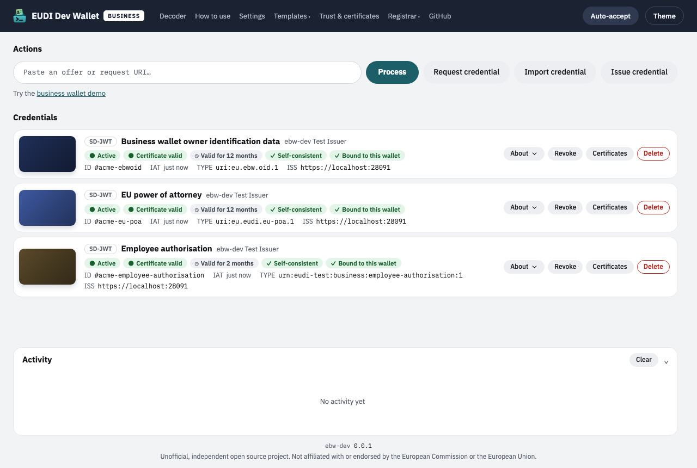

<p align="center">
  <picture>
    <source media="(prefers-color-scheme: dark)" srcset="docs/assets/logo-readme-dark.png">
    
  </picture>
</p>

# Test Business Wallet for the EUDI Ecosystem

ebw-dev is a test tool for the European Business Wallet. It runs on your machine. A test business wallet gives a scripted AI agent a mandate. The agent acts at 2 verifiers. Each verifier checks the whole delegation chain. The wallet is the [eudi-dev](https://github.com/eudi-dev/eudi-dev) test wallet with the configuration and theme of this repository.

ebw-dev is planned to become a business wallet with organisations, members and roles. The section [Planned](#planned) shows these features.

Everything is test data. All organisations and people are made up.

<p align="center">
  <picture>
    <source media="(prefers-color-scheme: dark)" srcset="docs/images/wallet-dark.png">
    
  </picture>
</p>

## Status of the specifications

- The European Business Wallet regulation is a proposal (COM(2025) 838).
- There is no Architecture and Reference Framework for business wallets.
- The credential formats come from the WE BUILD pilot.
- Delegate SD-JWT is at draft 00.

[Specifications](docs/specifications.md) lists the pinned version of each one.

## Principles

1. **Built on eudi-dev, free to differ.** ebw-dev uses the fundamentals of eudi-dev: formats, protocols, trust and debug tooling. Where a business wallet needs something else, ebw-dev does it differently.
2. **Faithful to the standards.** ebw-dev follows the real rules and every standard involved: the European Business Wallet proposal COM(2025) 838, Delegate SD-JWT, OpenID4VC, HAIP, the ARF and others. These standards change. [Specifications](docs/specifications.md) lists the implemented version of each one. The footer of the UI shows the version of ebw-dev. The code for each specification sits in one place.
3. **Made for testing and debugging.** ebw-dev brings the activity log, the decoder, the findings and the debug and strict modes of eudi-dev. It adds the same insight for the flows of a business wallet: organisation onboarding, member approval and delegation chains. Where it helps testing, ebw-dev is laxer than a real wallet, for example on security. The docs list every such difference.

## Highlights

**A test business wallet.** The eudi-dev wallet runs with the name EUDI Dev Wallet, its own logo and the BUSINESS tag. It holds 3 credentials of a test organisation: an EBWOID, an EU power of attorney and an employee authorisation. → [Theme](docs/theme.md)

**Delegation to an AI agent.** An agent service asks the wallet for a mandate over OpenID4VP 1.0 with `delegate` transaction data. The wallet signs a Delegate SD-JWT for the agent key. → [Architecture](docs/architecture.md), [chain format](docs/chain-format.md)

**2 cases with 5 refusals each.** An order at a supplier and an invoice approval inside the company. Each verifier reports every check of the chain with its result. → [AI agent demo](docs/agent-demo.md)

**Issuer and verifier scenarios.** A business issuer offers the 3 credentials over OpenID4VCI 1.0. A notary checks the scope and the validity of an EU power of attorney. 3 variants show a refusal: a wrong scope, an expired power and a revoked power. A bank asks for the owner identification data and the power of attorney in one request. The page lists the data sent to the bank. → [Scenarios](docs/scenarios.md)

**Trust from trusted lists.** The verifiers take their trust anchors from the trusted lists of the wallet and check the status of each credential. → [Trust](docs/architecture.md#trust)

## Planned

Each organisation gets its own business wallet with its own credentials, keys and activity log. Members sign in with a PID, and roles decide what they may present or delegate. [The plan](docs/plan.md) describes these features.

## Quick start

Requirements: Go 1.27 and an `eudi` wallet binary with Delegate SD-JWT. [Install](#install) shows how to build it.

```sh
scripts/run-local.sh
```

| Service | Address |
| --- | --- |
| Demo pages and JSON API | http://localhost:28090 |
| Business wallet | http://localhost:28085 |
| HTTPS issuer of the wallet | https://localhost:28091 |

→ [Local run](docs/local-run.md) for the ports, the state and the flags, and [all documentation](docs/README.md)

## Install

ebw-dev runs from source. The wallet comes from eudi-dev.

| Part | Source |
| --- | --- |
| ebw-dev | This repository. `scripts/run-local.sh` builds `bin/ebw-dev` |
| Wallet | eudi-dev 3.11.0 or later. It has Delegate SD-JWT behind `--delegate-sd-jwt`, the theme keys for the name, the page description and the demo links, `--issuer-name` and `--no-builtins` |

Install the wallet into `bin/eudi`. Run this from the root of this repository:

```sh
GOBIN="$PWD/bin" go install github.com/eudi-dev/eudi-dev/v3@v3.11.0
mv bin/eudi-dev bin/eudi
```

`WALLET_BIN` points `scripts/run-local.sh` at another wallet binary, for example `eudi` from Homebrew.

## Commands

| Command | Purpose | Docs |
| --- | --- | --- |
| `scripts/run-local.sh` | Starts the business wallet and the demo server | [Local run](docs/local-run.md) |
| `bin/ebw-dev` | Demo server with the agent service, the agent and the verifiers | [Local run](docs/local-run.md#flags) |
| `go test ./...` | Unit tests and both cases against a test wallet | [Contributing](CONTRIBUTING.md) |
| `scripts/e2e.sh` | Both cases and the refusal runs against the running setup | [Contributing](CONTRIBUTING.md) |
| `scripts/browser-check.sh` | Wallet and demo in Chromium with screenshots | [Contributing](CONTRIBUTING.md) |

The demo server also has a [JSON API](docs/http-api.md).

## Supported specifications

| Specification | Use |
| --- | --- |
| Delegate SD-JWT draft-ietf-oauth-delegate-sd-jwt-00 | The delegation chain and the `delegate` transaction data type |
| SD-JWT RFC 9901 and SD-JWT VC draft 19 | Format of the authority credentials |
| OpenID4VP 1.0 | Mandate request, proof request and the requests of the scenarios |
| HAIP 1.0 | Profile of the signed mandate request and the signed scenario requests |
| Token Status List draft 21 | Status check of the authority credential |
| OpenID4VCI 1.0 | Credential offers of the business issuer |
| ETSI TS 119 602 V1.1.1 | Trusted lists as the source of the trust anchors |
| WE BUILD rulebooks at commit adae9cb | EBWOID 1.1.0, EU power of attorney 0.2 and Power of X 1.2 |

[Specifications](docs/specifications.md) has the pinned versions and the links. [Differences from a real business wallet](docs/differences.md) lists where ebw-dev is laxer.

## Notices

**No EU affiliation:** This is an independent open source project. The European Commission and the European Union do not endorse it and it has no affiliation with them. "EUDI" refers to the target ecosystem (European Digital Identity).

Never use real credentials.

## License

Apache-2.0. See [LICENSE](LICENSE).
